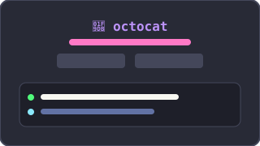
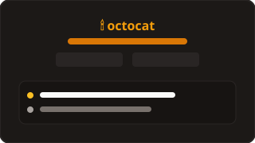
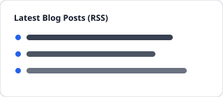
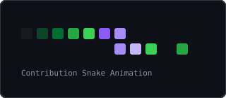
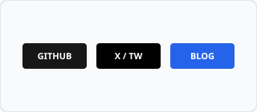
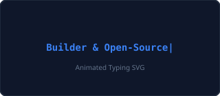
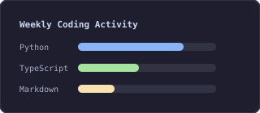

<div align="center">

# 🚀 Pro GitHub Starter Kit

[](https://github.com/cmduyeen/pro-github-starter-kit)

[](https://github.com/cmduyeen/pro-github-starter-kit/actions/workflows/validate-extensions.yml)
[](https://www.python.org/downloads/)
[](LICENSE)
[](https://github.com/cmduyeen/pro-github-starter-kit/generate)

**An Obsidian-inspired, extensible starter kit for crafting a clean, automated, and high-converting GitHub Profile.**

[Quick Start](#-quick-start-no-coding-required) · [Themes (9)](#-1-pick-a-theme-themes) · [Plugins (12)](#-2-snap-in-plugins-plugins) · [Resources & SEO](#-curated-resources--seo) · [Achievements](#-legit-github-achievements) · [FAQ](#-build-together-add-your-own-theme-or-plugin)

</div>

<details>
<summary><b>📑 Table of Contents</b></summary>

- [⚡ Quick Start (No Coding Required)](#-quick-start-no-coding-required)
- [🎨 See What You Can Build](#-see-what-you-can-build)
- [🧩 Modular Themes & Plugins](#-modular-themes--plugins)
  - [1. Pick a Theme (`themes/`)](#-1-pick-a-theme-themes)
  - [2. Snap in Plugins (`plugins/`)](#-2-snap-in-plugins-plugins)
- [🛠 Curated Resources & SEO](#-curated-resources--seo)
- [🏆 Legit GitHub Achievements](#-legit-github-achievements)
- [🤝 Build Together & FAQ](#-build-together-add-your-own-theme-or-plugin)

</details>

---

## ⚡ Quick Start (No Coding Required)

### Option A: 100% in Browser (Recommended for Beginners & Non-Tech)

No terminal, no Python, no Git commands needed:

1. Click **[Use this template](https://github.com/cmduyeen/pro-github-starter-kit/generate)** and name your new public repository **exactly** `<your-username>/<your-username>`.
2. Open the **Actions** tab in your new repository → select **Build My Profile** → click **Run workflow**.
3. Pick your **Theme** from the dropdown, tick the **Plugins** you want (optional: paste your Blog RSS or Spotify UID), and click **Run workflow**. GitHub automatically builds and commits your new `README.md`!

### Option B: Interactive Terminal Wizard (1 Simple Command)

If you prefer running locally, just clone your repo and run:

```bash
python setup.py
```

A guided Q&A menu will walk you through picking a theme and plugins by number—no flags to memorize.

<details>
<summary><b>Option C: One-Line CLI (For Power Users)</b></summary>

```bash
python setup.py --username <your-username> \
  --theme indie-maker \
  --plugins typing-svg,skill-icons,blog-rss,spotify-now-playing,github-stats \
  --var BLOG_RSS_URL=https://yourblog.com/index.xml \
  --var SPOTIFY_UID=your_spotify_uid
```

</details>

> [!TIP]
> Want to preview available options first? Run `python setup.py --list` or add `--dry-run`.

---

## 🎨 See What You Can Build

Why settle for plain text when you can snap together live, zero-maintenance widgets? Here is a live preview of what the built-in plugins render:

<div align="center">

**Tech Stack Grid (`skill-icons` plugin)**

[](https://skillicons.dev)

**Crisp Social & Contact Bar (`social-badges` plugin)**

[](https://github.com/cmduyeen)
[](https://x.com/cmduyeen)
[](https://cmduyeen.github.io)

</div>

---

## 🧩 Modular Themes & Plugins

Just like **Obsidian**, this kit separates **Layout (`themes/`)** from **Features (`plugins/`)** so you can mix, match, or contribute your own.

### 1. Pick a Theme (`themes/`)

Click any preview card or **Live Preview** link to see the rendered profile immediately on GitHub:

<!-- THEMES-TABLE:START -->
<table>
  <tr>
    <td align="center" valign="top" width="33%">
      <a href="themes/catppuccin/PREVIEW.md"></a><br/>
      <b><code>catppuccin</code></b> · <a href="themes/catppuccin/PREVIEW.md">Live Preview</a> · <a href="themes/catppuccin/README.template.md">Template</a><br/>
      <sub>Soothing pastel-dark palette inspired by Catppuccin (catppuccin/catppuccin). <i>(by @cmduyeen)</i></sub>
    </td>
    <td align="center" valign="top" width="33%">
      <a href="themes/developer-portfolio/PREVIEW.md"></a><br/>
      <b><code>developer-portfolio</code></b> · <a href="themes/developer-portfolio/PREVIEW.md">Live Preview</a> · <a href="themes/developer-portfolio/README.template.md">Template</a><br/>
      <sub>Full developer showcase ready for tech stack icons, stats cards, and activity widgets. <i>(by @cmduyeen)</i></sub>
    </td>
    <td align="center" valign="top" width="33%">
      <a href="themes/dracula/PREVIEW.md"></a><br/>
      <b><code>dracula</code></b> · <a href="themes/dracula/PREVIEW.md">Live Preview</a> · <a href="themes/dracula/README.template.md">Template</a><br/>
      <sub>Dark purple & neon palette inspired by Dracula Theme (dracula/dracula-theme). <i>(by @cmduyeen)</i></sub>
    </td>
  </tr>
  <tr>
    <td align="center" valign="top" width="33%">
      <a href="themes/indie-maker/PREVIEW.md"></a><br/>
      <b><code>indie-maker</code></b> · <a href="themes/indie-maker/PREVIEW.md">Live Preview</a> · <a href="themes/indie-maker/README.template.md">Template</a><br/>
      <sub>Product-focused layout highlighting shipped projects, writing, and updates. <i>(by @cmduyeen)</i></sub>
    </td>
    <td align="center" valign="top" width="33%">
      <a href="themes/minimalist/PREVIEW.md"></a><br/>
      <b><code>minimalist</code></b> · <a href="themes/minimalist/PREVIEW.md">Live Preview</a> · <a href="themes/minimalist/README.template.md">Template</a><br/>
      <sub>Clean text-first profile with zero visual clutter. <i>(by @cmduyeen)</i></sub>
    </td>
    <td align="center" valign="top" width="33%">
      <a href="themes/pinkie/PREVIEW.md"></a><br/>
      <b><code>pinkie</code></b> · <a href="themes/pinkie/PREVIEW.md">Live Preview</a> · <a href="themes/pinkie/README.template.md">Template</a><br/>
      <sub>Soft pastel-pink aesthetic from Pinkie Theme (cmduyeen/pinkie-theme). <i>(by @cmduyeen)</i></sub>
    </td>
  </tr>
  <tr>
    <td align="center" valign="top" width="33%">
      <a href="themes/research-student/PREVIEW.md"></a><br/>
      <b><code>research-student</code></b> · <a href="themes/research-student/PREVIEW.md">Live Preview</a> · <a href="themes/research-student/README.template.md">Template</a><br/>
      <sub>Structured layout highlighting learning roadmap, notes, and starter projects. <i>(by @cmduyeen)</i></sub>
    </td>
    <td align="center" valign="top" width="33%">
      <a href="themes/serein/PREVIEW.md"></a><br/>
      <b><code>serein</code></b> · <a href="themes/serein/PREVIEW.md">Live Preview</a> · <a href="themes/serein/README.template.md">Template</a><br/>
      <sub>Warm, low-distraction palette from Serein Theme (cmduyeen/serein-theme). <i>(by @cmduyeen)</i></sub>
    </td>
    <td align="center" valign="top" width="33%">
      <a href="themes/terminal-hacker/PREVIEW.md"></a><br/>
      <b><code>terminal-hacker</code></b> · <a href="themes/terminal-hacker/PREVIEW.md">Live Preview</a> · <a href="themes/terminal-hacker/README.template.md">Template</a><br/>
      <sub>Neofetch-inspired terminal block layout for CLI and systems developers. <i>(by @cmduyeen)</i></sub>
    </td>
  </tr>
</table>
<!-- THEMES-TABLE:END -->

### 2. Snap in Plugins (`plugins/`)

<!-- PLUGINS-TABLE:START -->
<table>
  <tr>
    <td align="center" valign="top" width="33%">
      <a href="plugins/activity-graph/PREVIEW.md"></a><br/>
      <b><code>activity-graph</code></b> · <a href="plugins/activity-graph/PREVIEW.md">Preview</a> · <a href="plugins/activity-graph/snippet.md">Snippet</a><br/>
      <sub>Renders a 31-day contribution line graph using github-readme-activity-graph. <i>(by @cmduyeen)</i></sub>
    </td>
    <td align="center" valign="top" width="33%">
      <a href="plugins/blog-rss/PREVIEW.md"></a><br/>
      <b><code>blog-rss</code></b> · <a href="plugins/blog-rss/PREVIEW.md">Preview</a> · <a href="plugins/blog-rss/snippet.md">Snippet</a><br/>
      <sub>Automatically syncs your latest blog posts via RSS using GitHub Actions. · <b>Auto-sync</b> <i>(by @cmduyeen)</i></sub>
    </td>
    <td align="center" valign="top" width="33%">
      <a href="plugins/github-stats/PREVIEW.md"></a><br/>
      <b><code>github-stats</code></b> · <a href="plugins/github-stats/PREVIEW.md">Preview</a> · <a href="plugins/github-stats/snippet.md">Snippet</a><br/>
      <sub>Embeds dynamic GitHub summary stats, top languages, and streak cards. <i>(by @cmduyeen)</i></sub>
    </td>
  </tr>
  <tr>
    <td align="center" valign="top" width="33%">
      <a href="plugins/profile-views/PREVIEW.md"></a><br/>
      <b><code>profile-views</code></b> · <a href="plugins/profile-views/PREVIEW.md">Preview</a> · <a href="plugins/profile-views/snippet.md">Snippet</a><br/>
      <sub>Adds a live profile visitor counter badge via komarev.com. <i>(by @cmduyeen)</i></sub>
    </td>
    <td align="center" valign="top" width="33%">
      <a href="plugins/skill-icons/PREVIEW.md"></a><br/>
      <b><code>skill-icons</code></b> · <a href="plugins/skill-icons/PREVIEW.md">Preview</a> · <a href="plugins/skill-icons/snippet.md">Snippet</a><br/>
      <sub>Displays your tech stack cleanly using skillicons.dev. <i>(by @cmduyeen)</i></sub>
    </td>
    <td align="center" valign="top" width="33%">
      <a href="plugins/snake-contribution/PREVIEW.md"></a><br/>
      <b><code>snake-contribution</code></b> · <a href="plugins/snake-contribution/PREVIEW.md">Preview</a> · <a href="plugins/snake-contribution/snippet.md">Snippet</a><br/>
      <sub>Generates an animated SVG snake eating your contribution graph daily via Platane/snk. · <b>Auto-sync</b> <i>(by @cmduyeen)</i></sub>
    </td>
  </tr>
  <tr>
    <td align="center" valign="top" width="33%">
      <a href="plugins/social-badges/PREVIEW.md"></a><br/>
      <b><code>social-badges</code></b> · <a href="plugins/social-badges/PREVIEW.md">Preview</a> · <a href="plugins/social-badges/snippet.md">Snippet</a><br/>
      <sub>Adds crisp shields.io social and portfolio badges. <i>(by @cmduyeen)</i></sub>
    </td>
    <td align="center" valign="top" width="33%">
      <a href="plugins/sponsor-badge/PREVIEW.md"></a><br/>
      <b><code>sponsor-badge</code></b> · <a href="plugins/sponsor-badge/PREVIEW.md">Preview</a> · <a href="plugins/sponsor-badge/snippet.md">Snippet</a><br/>
      <sub>Adds GitHub Sponsors and support buttons to help fund your open-source work. <i>(by @cmduyeen)</i></sub>
    </td>
    <td align="center" valign="top" width="33%">
      <a href="plugins/spotify-now-playing/PREVIEW.md"></a><br/>
      <b><code>spotify-now-playing</code></b> · <a href="plugins/spotify-now-playing/PREVIEW.md">Preview</a> · <a href="plugins/spotify-now-playing/snippet.md">Snippet</a><br/>
      <sub>Displays your currently playing or recently played Spotify track. <i>(by @cmduyeen)</i></sub>
    </td>
  </tr>
  <tr>
    <td align="center" valign="top" width="33%">
      <a href="plugins/typing-svg/PREVIEW.md"></a><br/>
      <b><code>typing-svg</code></b> · <a href="plugins/typing-svg/PREVIEW.md">Preview</a> · <a href="plugins/typing-svg/snippet.md">Snippet</a><br/>
      <sub>Adds an animated typing header powered by readme-typing-svg. <i>(by @cmduyeen)</i></sub>
    </td>
    <td align="center" valign="top" width="33%">
      <a href="plugins/wakatime-stats/PREVIEW.md"></a><br/>
      <b><code>wakatime-stats</code></b> · <a href="plugins/wakatime-stats/PREVIEW.md">Preview</a> · <a href="plugins/wakatime-stats/snippet.md">Snippet</a><br/>
      <sub>Automatically updates your weekly coding time and language breakdown via WakaTime. · <b>Auto-sync</b> <i>(by @cmduyeen)</i></sub>
    </td>
    <td align="center" valign="top" width="33%">
      <a href="plugins/youtube-rss/PREVIEW.md"></a><br/>
      <b><code>youtube-rss</code></b> · <a href="plugins/youtube-rss/PREVIEW.md">Preview</a> · <a href="plugins/youtube-rss/snippet.md">Snippet</a><br/>
      <sub>Automatically lists your latest YouTube videos via channel RSS feed. · <b>Auto-sync</b> <i>(by @cmduyeen)</i></sub>
    </td>
  </tr>
</table>
<!-- PLUGINS-TABLE:END -->

> [!NOTE]
> All GitHub Actions workflows run **once per day** and only commit when new content appears—keeping your contribution graph authentic and clean. See **[docs/AUTOMATION.md](docs/AUTOMATION.md)** for setup details.

---

## 🛠 Curated Resources & SEO

### Famous Tools & Open-Source Repositories

We vetted the most reliable profile builders, SVG widgets, color palettes, and automation workflows—with direct links and usage notes:

| Category | Popular Tools & Repos | Why Use Them | Full Guide |
| --- | --- | --- | --- |
| **Visual Builders** | [readme.so](https://readme.so/) · [github-profile-readme-generator](https://github.com/rahuldkjain/github-profile-readme-generator) | Drag-and-drop Markdown blocks without writing syntax from scratch | [RESOURCES.md](docs/RESOURCES.md) |
| **Stats & Graphs** | [streak-stats](https://github.com/DenverCoder1/github-readme-streak-stats) · [activity-graph](https://github.com/ashutosh00710/github-readme-activity-graph) · [github-readme-stats](https://github.com/anuraghazra/github-readme-stats) · [metrics](https://github.com/lowlighter/metrics) | Showcase coding streaks, 31-day activity, and language stats *(self-host `github-readme-stats` on Vercel to avoid 503 limits)* | [RESOURCES.md](docs/RESOURCES.md) |
| **Icons & Badges** | [skill-icons](https://github.com/tandpfun/skill-icons) · [shields.io](https://shields.io/) · [simpleicons.org](https://simpleicons.org/) · [readme-typing-svg](https://github.com/DenverCoder1/readme-typing-svg) | Crisp SVG tech grids, custom social buttons, and animated typing headers | [RESOURCES.md](docs/RESOURCES.md) |
| **Automation** | [blog-post-workflow](https://github.com/gautamkrishnar/blog-post-workflow) · [Platane/snk](https://github.com/Platane/snk) · [waka-readme-stats](https://github.com/anmol098/waka-readme-stats) · [spotify-github-profile](https://github.com/kittinan/spotify-github-profile) | Auto-sync Blog/YouTube RSS, contribution snake, WakaTime, and Spotify | [AUTOMATION.md](docs/AUTOMATION.md) |
| **Color Palettes** | [catppuccin](https://github.com/catppuccin/catppuccin) · [dracula](https://github.com/dracula/dracula-theme) · [serein-theme](https://github.com/cmduyeen/serein-theme) · [pinkie-theme](https://github.com/cmduyeen/pinkie-theme) | Cohesive color systems for profiles, editors, and terminals | [Themes](#-1-pick-a-theme-themes) |
| **Inspiration** | [awesome-github-profile-readme](https://github.com/abhisheknaiidu/awesome-github-profile-readme) · [creative-profile-readme](https://github.com/coderjojo/creative-profile-readme) | Hundreds of real-world creative and minimalist profile examples | [RESOURCES.md](docs/RESOURCES.md) |

### GitHub SEO & GEO Checklist (Rank on Google, GitHub & AI Search)

<details>
<summary><b>🔍 Click to open the 4-Part GitHub SEO & GEO Checklist</b></summary>

1. **Profile Sidebar (First 5 Seconds):**
   - Use a recognizable **Name** (`Name (handle)`), a crisp **1-line Bio** stating what you build, and link your **Website/Blog** + **Social handle**.
2. **The 6 Pinned Repositories Strategy:**
   - Pin **6 flagship "gateway" repositories** (e.g., 1 main product, 1 theme/design system, 1 starter kit, 1 knowledge base/blog) instead of scattered minor sub-repos.
3. **Per-Repository On-Page SEO:**
   - **URL Slug:** Clear kebab-case keywords (e.g., `pro-github-starter-kit`).
   - **Description (140–160 chars):** Lead with primary keywords and clear value.
   - **Topics (up to 20/20):** Mix broad tags (`python`, `open-source`) with high-intent tags (`github-profile-readme`, `starter-kit`).
   - **Social Preview (`1280×640px`):** Upload a custom banner in **Settings → General → Social preview** for rich link cards on X, LinkedIn, and Discord.
4. **GEO (Generative Engine Optimization for AI Search):**
   - Add an **`llms.txt`** at the repo root summarizing key files, use **structured Markdown tables** with exact numbers, and include a direct **FAQ** section.

</details>

See the full printable checklist in **[docs/SEO-CHECKLIST.md](docs/SEO-CHECKLIST.md)**.

---

## 🏆 Legit GitHub Achievements

All **7 active GitHub Achievement Badges**, their tier thresholds, and legitimate ways to unlock them through real workflows:

| Badge | Exact Requirement | Tiers (Default / Bronze / Silver / Gold) | Legit Tip for Beginners |
| --- | --- | --- | --- |
| 🦈 **Pull Shark** | Open pull requests that get merged | 2 / 16 / 128 / 1,024 PRs | Use feature branches + PRs for your own projects, or fix typos in open-source docs |
| 👯 **Pair Extraordinaire** | Co-author a commit in a merged PR | 1 / 10 / 24 / 48 PRs | Add `Co-authored-by: Name <email>` in your commit footer when pairing with a friend |
| 🚀 **Quickdraw** | Close an issue or PR within **5 minutes** | 1 fast close *(single tier)* | Open an issue for a quick fix you already have ready, then close it right after |
| 🤠 **YOLO** | Merge a PR **without a code review** | 1 unreviewed merge *(single tier)* | On your own project, merge a real update PR directly without requesting review |
| 🧠 **Galaxy Brain** | Accepted answer in GitHub Discussions | 2 / 8 / 16 / 32 answers | Answer `Q&A` questions in repos you use and wait for *Mark as answer* |
| ⭐ **Starstruck** | Own a public repo hitting star milestones | 16 / 128 / 512 / 4,096 stars | Ship a genuinely helpful tool/kit with live previews & clean SEO topics |
| 💖 **Public Sponsor** | Sponsor an open-source dev/org | 1 sponsorship *(single tier)* | Sponsor any maintainer via **GitHub Sponsors** (even $1/month) |

<details>
<summary><b>📌 Step-by-Step: Unlock Your First 4 Badges Legitimately (No Bots Needed)</b></summary>

1. **Pull Shark + YOLO:** Instead of pushing directly to `main` on your personal project, create a real branch (`git checkout -b docs/update-bio`), edit your file, open a Pull Request on GitHub, and click **Merge pull request** without review (**YOLO** unlocked; do this for 2 real updates for **Pull Shark**).
2. **Pair Extraordinaire:** When collaborating on a PR, end your commit message with a blank line followed by:
   ```text
   Co-authored-by: Teammate Name <teammate-github-email@example.com>
   ```
   *(The email must belong to a real GitHub account).*
3. **Quickdraw:** When you notice a small bug or missing link in your repo, open an Issue, push the fix, and close the Issue within 5 minutes.

</details>

<details>
<summary><b>🎖️ Profile Highlights, Retired Badges & Common Myths</b></summary>

- **Profile Highlights (Sidebar):** `GitHub Pro` (free for students via GitHub Education) and `GitHub Developer Program` member badge.
- **Retired Badges (No longer obtainable):** `Arctic Code Vault Contributor` (2020 snapshot) and `Mars 2020 Helicopter Contributor`.
- **Green Squares ≠ Badge:** The contribution calendar tracks daily activity, not an Achievement Badge.

</details>

> [!WARNING]
> Never use bots to push empty commits or loop fake PRs. That violates GitHub's Acceptable Use Policies (*Spam and Inauthentic Activity*) and risks account flagging. Read **[docs/BADGES.md](docs/BADGES.md)** for full details.

---

## 🤝 Build Together (Add Your Own Theme or Plugin)

Want to share your own layout or widget with the community? Drop a folder into `themes/<id>/` or `plugins/<id>/` with its JSON manifest and open a PR—our CI automatically validates everything! See **[CONTRIBUTING.md](CONTRIBUTING.md)**.

<details>
<summary><b>❓ FAQ — Quick Answers</b></summary>

1. **How do I activate my GitHub Profile README?**  
   Create a public repository named `<your-username>/<your-username>` with a `README.md` at the root.
2. **Do I need to install any Python packages to use `setup.py`?**  
   No. `setup.py` uses only the Python 3.10+ standard library.
3. **How do I sync my YouTube channel or blog automatically?**  
   Enable `--plugins blog-rss,youtube-rss` when running `setup.py`, then pass your RSS URL or YouTube Channel ID (`UC...`).

</details>

---

<div align="center">

[MIT License](LICENSE) · Crafted by [cmduyeen](https://github.com/cmduyeen) · **Star ⭐ this repo if it helped you level up your profile!**

</div>
