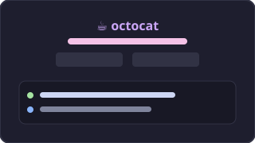
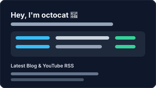
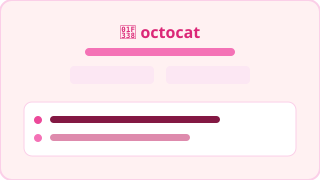
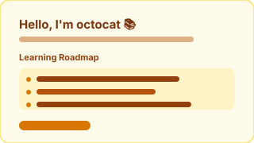
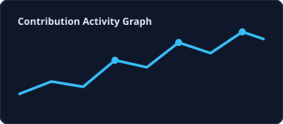
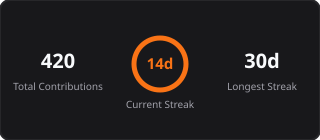
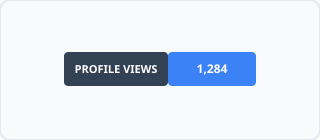
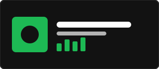

<div align="center">

# 🚀 Pro GitHub Starter Kit

[](https://github.com/cmduyeen/pro-github-starter-kit)

[](https://github.com/cmduyeen/pro-github-starter-kit/actions/workflows/validate-extensions.yml)
[](https://www.python.org/downloads/)
[](LICENSE)
[](https://github.com/cmduyeen/pro-github-starter-kit/generate)

**An Obsidian-inspired, extensible starter kit for crafting a clean, automated, and high-converting GitHub Profile.**

[Quick Start](#-quick-start-no-coding-required) · [Live Preview](#-see-what-you-can-build) · [Themes (9)](#-1-pick-a-theme-themes) · [Plugins (12)](#-2-snap-in-plugins-plugins) · [Badges](#-legit-github-achievements)

</div>

---

## 📑 Table of Contents

- [⚡ Quick Start (No Coding Required)](#-quick-start-no-coding-required)
  - [Option A: 100% in Browser (Recommended)](#option-a-100-in-browser-recommended-for-beginners--non-tech)
  - [Option B: Interactive Terminal Wizard](#option-b-interactive-terminal-wizard-1-simple-command)
- [🎨 See What You Can Build](#-see-what-you-can-build)
- [🧩 Modular Themes & Plugins](#-modular-themes--plugins)
  - [1. Pick a Theme (`themes/`)](#-1-pick-a-theme-themes)
  - [2. Snap in Plugins (`plugins/`)](#-2-snap-in-plugins-plugins)
- [🛠 Curated Resources & SEO](#-curated-resources--seo)
- [🏆 Legit GitHub Achievements](#-legit-github-achievements)
- [🤝 Build Together & FAQ](#-build-together-add-your-own-theme-or-plugin)

---

## ⚡ Quick Start (No Coding Required)

### Option A: 100% in Browser (Recommended for Beginners & Non-Tech)

No terminal, no Python, no Git commands needed:

1. Click **[Use this template](https://github.com/cmduyeen/pro-github-starter-kit/generate)** and name your new public repository **exactly** `<your-username>/<your-username>`.
2. Open the **Actions** tab in your new repository → select **Build My Profile** → click **Run workflow**.
3. Pick your **Theme** from the dropdown, tick the **Plugins** you want (optional: paste your Blog RSS or Spotify UID), and click **Run workflow**. GitHub automatically builds and commits your new `README.md`!

### Option B: Interactive Terminal Wizard (1 Simple Command)

If you prefer running locally, just clone your repo and run:

```bash
python setup.py
```

A guided Q&A menu will walk you through picking a theme and plugins by number—no flags to memorize.

<details>
<summary><b>Option C: One-Line CLI (For Power Users)</b></summary>

```bash
python setup.py --username <your-username> \
  --theme indie-maker \
  --plugins typing-svg,skill-icons,blog-rss,spotify-now-playing,github-stats \
  --var BLOG_RSS_URL=https://yourblog.com/index.xml \
  --var SPOTIFY_UID=your_spotify_uid
```

</details>

> [!TIP]
> Want to preview available options first? Run `python setup.py --list` or add `--dry-run`.

---

## 🎨 See What You Can Build

Why settle for plain text when you can snap together live, zero-maintenance widgets? Here is a live preview of what the built-in plugins render:

<div align="center">

**Tech Stack Grid (`skill-icons` plugin)**

[](https://skillicons.dev)

**Crisp Social & Contact Bar (`social-badges` plugin)**

[](https://github.com/cmduyeen)
[](https://x.com/cmduyeen)
[](https://cmduyeen.github.io)

</div>

---

## 🧩 Modular Themes & Plugins

Just like **Obsidian**, this kit separates **Layout (`themes/`)** from **Features (`plugins/`)** so you can mix, match, or contribute your own.

### 1. Pick a Theme (`themes/`)

Click any preview card or **Live Preview** link to see the rendered profile immediately on GitHub:

<!-- THEMES-TABLE:START -->
| Preview | Theme | Description | Quick Links |
| :---: | --- | --- | --- |
| [](themes/catppuccin/PREVIEW.md) | **`catppuccin`**<br/>Catppuccin Mocha *(by @cmduyeen)* | Soothing pastel-dark palette inspired by Catppuccin (catppuccin/catppuccin). | [Live Preview](themes/catppuccin/PREVIEW.md) · [Template](themes/catppuccin/README.template.md) |
| [](themes/developer-portfolio/PREVIEW.md) | **`developer-portfolio`**<br/>Developer Portfolio *(by @cmduyeen)* | Full developer showcase ready for tech stack icons, stats cards, and activity widgets. | [Live Preview](themes/developer-portfolio/PREVIEW.md) · [Template](themes/developer-portfolio/README.template.md) |
| [](themes/dracula/PREVIEW.md) | **`dracula`**<br/>Dracula Palette *(by @cmduyeen)* | Dark purple & neon palette inspired by Dracula Theme (dracula/dracula-theme). | [Live Preview](themes/dracula/PREVIEW.md) · [Template](themes/dracula/README.template.md) |
| [](themes/indie-maker/PREVIEW.md) | **`indie-maker`**<br/>Indie Maker *(by @cmduyeen)* | Product-focused layout highlighting shipped projects, writing, and updates. | [Live Preview](themes/indie-maker/PREVIEW.md) · [Template](themes/indie-maker/README.template.md) |
| [](themes/minimalist/PREVIEW.md) | **`minimalist`**<br/>Minimalist *(by @cmduyeen)* | Clean text-first profile with zero visual clutter. | [Live Preview](themes/minimalist/PREVIEW.md) · [Template](themes/minimalist/README.template.md) |
| [](themes/pinkie/PREVIEW.md) | **`pinkie`**<br/>Pinkie Pastel *(by @cmduyeen)* | Soft pastel-pink aesthetic from Pinkie Theme (cmduyeen/pinkie-theme). | [Live Preview](themes/pinkie/PREVIEW.md) · [Template](themes/pinkie/README.template.md) |
| [](themes/research-student/PREVIEW.md) | **`research-student`**<br/>Student & Self-Learner *(by @cmduyeen)* | Structured layout highlighting learning roadmap, notes, and starter projects. | [Live Preview](themes/research-student/PREVIEW.md) · [Template](themes/research-student/README.template.md) |
| [](themes/serein/PREVIEW.md) | **`serein`**<br/>Serein Warm Minimal *(by @cmduyeen)* | Warm, low-distraction palette from Serein Theme (cmduyeen/serein-theme). | [Live Preview](themes/serein/PREVIEW.md) · [Template](themes/serein/README.template.md) |
| [](themes/terminal-hacker/PREVIEW.md) | **`terminal-hacker`**<br/>Terminal / CLI *(by @cmduyeen)* | Neofetch-inspired terminal block layout for CLI and systems developers. | [Live Preview](themes/terminal-hacker/PREVIEW.md) · [Template](themes/terminal-hacker/README.template.md) |
<!-- THEMES-TABLE:END -->

### 2. Snap in Plugins (`plugins/`)

<!-- PLUGINS-TABLE:START -->
| Preview | Plugin | Description | Quick Links |
| :---: | --- | --- | --- |
| [](plugins/activity-graph/PREVIEW.md) | **`activity-graph`**<br/>*(by @cmduyeen)* | Renders a 31-day contribution line graph using github-readme-activity-graph. | [Live Preview](plugins/activity-graph/PREVIEW.md) · [Snippet](plugins/activity-graph/snippet.md) |
| [](plugins/blog-rss/PREVIEW.md) | **`blog-rss`**<br/>*(by @cmduyeen · *Auto-sync*)* | Automatically syncs your latest blog posts via RSS using GitHub Actions. | [Live Preview](plugins/blog-rss/PREVIEW.md) · [Snippet](plugins/blog-rss/snippet.md) |
| [](plugins/github-stats/PREVIEW.md) | **`github-stats`**<br/>*(by @cmduyeen)* | Embeds dynamic GitHub summary stats, top languages, and streak cards. | [Live Preview](plugins/github-stats/PREVIEW.md) · [Snippet](plugins/github-stats/snippet.md) |
| [](plugins/profile-views/PREVIEW.md) | **`profile-views`**<br/>*(by @cmduyeen)* | Adds a live profile visitor counter badge via komarev.com. | [Live Preview](plugins/profile-views/PREVIEW.md) · [Snippet](plugins/profile-views/snippet.md) |
| [](plugins/skill-icons/PREVIEW.md) | **`skill-icons`**<br/>*(by @cmduyeen)* | Displays your tech stack cleanly using skillicons.dev. | [Live Preview](plugins/skill-icons/PREVIEW.md) · [Snippet](plugins/skill-icons/snippet.md) |
| [](plugins/snake-contribution/PREVIEW.md) | **`snake-contribution`**<br/>*(by @cmduyeen · *Auto-sync*)* | Generates an animated SVG snake eating your contribution graph daily via Platane/snk. | [Live Preview](plugins/snake-contribution/PREVIEW.md) · [Snippet](plugins/snake-contribution/snippet.md) |
| [](plugins/social-badges/PREVIEW.md) | **`social-badges`**<br/>*(by @cmduyeen)* | Adds crisp shields.io social and portfolio badges. | [Live Preview](plugins/social-badges/PREVIEW.md) · [Snippet](plugins/social-badges/snippet.md) |
| [](plugins/sponsor-badge/PREVIEW.md) | **`sponsor-badge`**<br/>*(by @cmduyeen)* | Adds GitHub Sponsors and support buttons to help fund your open-source work. | [Live Preview](plugins/sponsor-badge/PREVIEW.md) · [Snippet](plugins/sponsor-badge/snippet.md) |
| [](plugins/spotify-now-playing/PREVIEW.md) | **`spotify-now-playing`**<br/>*(by @cmduyeen)* | Displays your currently playing or recently played Spotify track. | [Live Preview](plugins/spotify-now-playing/PREVIEW.md) · [Snippet](plugins/spotify-now-playing/snippet.md) |
| [](plugins/typing-svg/PREVIEW.md) | **`typing-svg`**<br/>*(by @cmduyeen)* | Adds an animated typing header powered by readme-typing-svg. | [Live Preview](plugins/typing-svg/PREVIEW.md) · [Snippet](plugins/typing-svg/snippet.md) |
| [](plugins/wakatime-stats/PREVIEW.md) | **`wakatime-stats`**<br/>*(by @cmduyeen · *Auto-sync*)* | Automatically updates your weekly coding time and language breakdown via WakaTime. | [Live Preview](plugins/wakatime-stats/PREVIEW.md) · [Snippet](plugins/wakatime-stats/snippet.md) |
| [](plugins/youtube-rss/PREVIEW.md) | **`youtube-rss`**<br/>*(by @cmduyeen · *Auto-sync*)* | Automatically lists your latest YouTube videos via channel RSS feed. | [Live Preview](plugins/youtube-rss/PREVIEW.md) · [Snippet](plugins/youtube-rss/snippet.md) |
<!-- PLUGINS-TABLE:END -->

> [!NOTE]
> All GitHub Actions workflows run **once per day** and only commit when new content appears—keeping your contribution graph authentic and clean. See **[docs/AUTOMATION.md](docs/AUTOMATION.md)** for setup details.

---

## 🛠 Curated Resources & SEO

We vetted the top open-source profile tools so you don't have to hunt across 20 tabs:

| Category | Top Picks | Guide |
| --- | --- | --- |
| **Visual Builders** | `readme.so`, `github-profile-readme-generator` | [docs/RESOURCES.md](docs/RESOURCES.md) |
| **Stats & Graphs** | `github-readme-stats`, `streak-stats`, `activity-graph`, `lowlighter/metrics` | [docs/RESOURCES.md](docs/RESOURCES.md) |
| **Automation** | `blog-post-workflow`, `waka-readme-stats`, `spotify-github-profile` | [docs/AUTOMATION.md](docs/AUTOMATION.md) |
| **Profile SEO & GEO** | 1-line Bio, 6 Gateway Pins, 20 Topics, `1280×640` Cover, `llms.txt` | [docs/SEO-CHECKLIST.md](docs/SEO-CHECKLIST.md) |
| **Inspiration** | `awesome-github-profile-readme`, `creative-profile-readme` | [docs/RESOURCES.md](docs/RESOURCES.md) |

---

## 🏆 Legit GitHub Achievements

| Badge | Requirement | Tiers (Default / Bronze / Silver / Gold) |
| --- | --- | --- |
| 🦈 **Pull Shark** | Open pull requests that get merged | 2 / 16 / 128 / 1,024 PRs |
| 👯 **Pair Extraordinaire** | Co-author a commit in a merged PR (`Co-authored-by:`) | 1 / 10 / 24 / 48 PRs |
| 🚀 **Quickdraw** | Close an issue or PR within **5 minutes** of opening | 1 fast close (single tier) |
| 🤠 **YOLO** | Merge a pull request **without a code review** | 1 unreviewed merge (single tier) |
| 🧠 **Galaxy Brain** | Accepted answer in GitHub Discussions (Q&A) | 2 / 8 / 16 / 32 answers |
| ⭐ **Starstruck** | Own a public repo reaching star milestones | 16 / 128 / 512 / 4,096 stars |
| 💖 **Public Sponsor** | Sponsor a developer/org via GitHub Sponsors | 1 sponsorship (single tier) |

> [!WARNING]
> Never use bots to push empty commits or loop fake PRs. That violates GitHub's Acceptable Use Policies (*Spam and Inauthentic Activity*) and risks account flagging. Read **[docs/BADGES.md](docs/BADGES.md)** for fast, 100% legitimate ways to earn every badge.

---

## 🤝 Build Together (Add Your Own Theme or Plugin)

Want to share your own layout or widget with the community? Drop a folder into `themes/<id>/` or `plugins/<id>/` with its JSON manifest and open a PR—our CI automatically validates everything! See **[CONTRIBUTING.md](CONTRIBUTING.md)**.

<details>
<summary><b>❓ FAQ — Quick Answers</b></summary>

1. **How do I activate my GitHub Profile README?**  
   Create a public repository named `<your-username>/<your-username>` with a `README.md` at the root.
2. **Do I need to install any Python packages to use `setup.py`?**  
   No. `setup.py` uses only the Python 3.10+ standard library.
3. **How do I sync my YouTube channel or blog automatically?**  
   Enable `--plugins blog-rss,youtube-rss` when running `setup.py`, then pass your RSS URL or YouTube Channel ID (`UC...`).

</details>

---

<div align="center">

[MIT License](LICENSE) · Crafted by [cmduyeen](https://github.com/cmduyeen) · **Star ⭐ this repo if it helped you level up your profile!**

</div>
