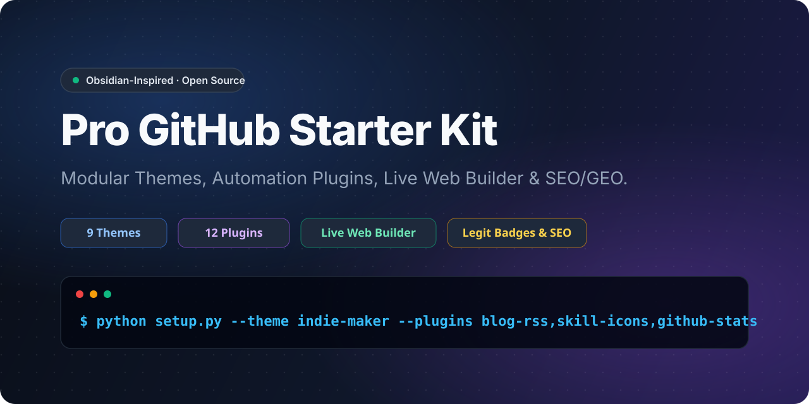
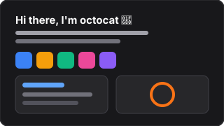
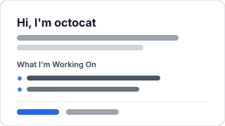
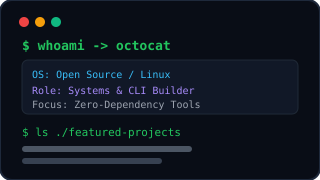
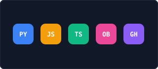

<div align="center">



# 🚀 Pro GitHub Starter Kit

[](https://github.com/cmduyeen/pro-github-starter-kit)

[](https://github.com/cmduyeen/pro-github-starter-kit/actions/workflows/validate-extensions.yml)
[](https://www.python.org/downloads/)
[](LICENSE)
[](https://github.com/cmduyeen/pro-github-starter-kit/generate)
[](https://cmduyeen.github.io/pro-github-starter-kit/)

**An Obsidian-inspired, extensible starter kit for crafting a clean, automated, and high-converting GitHub Profile.**

[Quick Start](#-quick-start-no-coding-required) · [Themes (9)](#-1-pick-a-theme-themes) · [Plugins (12)](#-2-snap-in-plugins-plugins) · [Resources & SEO](#-curated-resources--seo) · [Achievements](#-legit-github-achievements) · [FAQ](#-build-together-add-your-own-theme-or-plugin)

</div>

<details>
<summary><b>📑 Table of Contents</b></summary>

- [⚡ Quick Start (No Coding Required)](#-quick-start-no-coding-required)
- [🎨 See What You Can Build](#-see-what-you-can-build)
- [🧩 Modular Themes & Plugins](#-modular-themes--plugins)
  - [1. Pick a Theme (`themes/`)](#-1-pick-a-theme-themes)
  - [2. Snap in Plugins (`plugins/`)](#-2-snap-in-plugins-plugins)
- [🛠 Curated Resources & SEO](#-curated-resources--seo)
- [🏆 Legit GitHub Achievements](#-legit-github-achievements)
- [🤝 Build Together & FAQ](#-build-together-add-your-own-theme-or-plugin)

</details>

---

## ⚡ Quick Start (No Coding Required)

### Option A: Visual Web Builder (Fastest — Zero Setup)

Open **[https://cmduyeen.github.io/pro-github-starter-kit/](https://cmduyeen.github.io/pro-github-starter-kit/)**, enter your username, pick a theme & plugins, and click **Copy Markdown** or **Download `README.md`**.

### Option B: 100% in Browser via GitHub Actions

No terminal, no Python, no Git commands needed:

1. Click **[Use this template](https://github.com/cmduyeen/pro-github-starter-kit/generate)** and name your new public repository **exactly** `<your-username>/<your-username>`.
2. Open the **Actions** tab in your new repository → select **Build My Profile** → click **Run workflow**.
3. Pick your **Theme** from the dropdown, tick the **Plugins** you want (optional: paste your Blog RSS or Spotify UID), and click **Run workflow**. GitHub automatically builds and commits your new `README.md`!

### Option B: Interactive Terminal Wizard (1 Simple Command)

If you prefer running locally, just clone your repo and run:

```bash
python setup.py
```

A guided Q&A menu will walk you through picking a theme and plugins by number—no flags to memorize.

<details>
<summary><b>Option C: One-Line CLI (For Power Users)</b></summary>

```bash
python setup.py --username <your-username> \
  --theme indie-maker \
  --plugins typing-svg,skill-icons,blog-rss,spotify-now-playing,github-stats \
  --var BLOG_RSS_URL=https://yourblog.com/index.xml \
  --var SPOTIFY_UID=your_spotify_uid
```

</details>

> [!TIP]
> Want to preview available options first? Run `python setup.py --list` or add `--dry-run`.

---

## 🎨 See What You Can Build

Why settle for plain text when you can snap together live, zero-maintenance widgets? Here is a live preview of what the built-in plugins render:

<div align="center">

**Tech Stack Grid (`skill-icons` plugin)**

[](https://skillicons.dev)

**Crisp Social & Contact Bar (`social-badges` plugin)**

[](https://github.com/cmduyeen)
[](https://x.com/cmduyeen)
[](https://cmduyeen.github.io)

</div>

---

## 🧩 Modular Themes & Plugins

Just like **Obsidian**, this kit separates **Layout (`themes/`)** from **Features (`plugins/`)** so you can mix, match, or contribute your own.

### 1. Pick a Theme (`themes/`)

Click any preview card or **Live Preview** link to see the rendered profile immediately on GitHub:

<!-- THEMES-TABLE:START -->
<table>
  <tr>
    <td align="center" valign="top" width="33%">
      <a href="themes/catppuccin/PREVIEW.md"></a><br/>
      <b><code>catppuccin</code></b> · <a href="themes/catppuccin/PREVIEW.md">Live Preview</a> · <a href="themes/catppuccin/README.template.md">Template</a><br/>
      <sub>Soothing pastel-dark palette inspired by Catppuccin (catppuccin/catppuccin). <i>(by @cmduyeen)</i></sub>
    </td>
    <td align="center" valign="top" width="33%">
      <a href="themes/developer-portfolio/PREVIEW.md"></a><br/>
      <b><code>developer-portfolio</code></b> · <a href="themes/developer-portfolio/PREVIEW.md">Live Preview</a> · <a href="themes/developer-portfolio/README.template.md">Template</a><br/>
      <sub>Full developer showcase ready for tech stack icons, stats cards, and activity widgets. <i>(by @cmduyeen)</i></sub>
    </td>
    <td align="center" valign="top" width="33%">
      <a href="themes/dracula/PREVIEW.md"></a><br/>
      <b><code>dracula</code></b> · <a href="themes/dracula/PREVIEW.md">Live Preview</a> · <a href="themes/dracula/README.template.md">Template</a><br/>
      <sub>Dark purple & neon palette inspired by Dracula Theme (dracula/dracula-theme). <i>(by @cmduyeen)</i></sub>
    </td>
  </tr>
  <tr>
    <td align="center" valign="top" width="33%">
      <a href="themes/indie-maker/PREVIEW.md"></a><br/>
      <b><code>indie-maker</code></b> · <a href="themes/indie-maker/PREVIEW.md">Live Preview</a> · <a href="themes/indie-maker/README.template.md">Template</a><br/>
      <sub>Product-focused layout highlighting shipped projects, writing, and updates. <i>(by @cmduyeen)</i></sub>
    </td>
    <td align="center" valign="top" width="33%">
      <a href="themes/minimalist/PREVIEW.md"></a><br/>
      <b><code>minimalist</code></b> · <a href="themes/minimalist/PREVIEW.md">Live Preview</a> · <a href="themes/minimalist/README.template.md">Template</a><br/>
      <sub>Clean text-first profile with zero visual clutter. <i>(by @cmduyeen)</i></sub>
    </td>
    <td align="center" valign="top" width="33%">
      <a href="themes/pinkie/PREVIEW.md"></a><br/>
      <b><code>pinkie</code></b> · <a href="themes/pinkie/PREVIEW.md">Live Preview</a> · <a href="themes/pinkie/README.template.md">Template</a><br/>
      <sub>Soft pastel-pink aesthetic from Pinkie Theme (cmduyeen/pinkie-theme). <i>(by @cmduyeen)</i></sub>
    </td>
  </tr>
  <tr>
    <td align="center" valign="top" width="33%">
      <a href="themes/research-student/PREVIEW.md"></a><br/>
      <b><code>research-student</code></b> · <a href="themes/research-student/PREVIEW.md">Live Preview</a> · <a href="themes/research-student/README.template.md">Template</a><br/>
      <sub>Structured layout highlighting learning roadmap, notes, and starter projects. <i>(by @cmduyeen)</i></sub>
    </td>
    <td align="center" valign="top" width="33%">
      <a href="themes/serein/PREVIEW.md"></a><br/>
      <b><code>serein</code></b> · <a href="themes/serein/PREVIEW.md">Live Preview</a> · <a href="themes/serein/README.template.md">Template</a><br/>
      <sub>Warm, low-distraction palette from Serein Theme (cmduyeen/serein-theme). <i>(by @cmduyeen)</i></sub>
    </td>
    <td align="center" valign="top" width="33%">
      <a href="themes/terminal-hacker/PREVIEW.md"></a><br/>
      <b><code>terminal-hacker</code></b> · <a href="themes/terminal-hacker/PREVIEW.md">Live Preview</a> · <a href="themes/terminal-hacker/README.template.md">Template</a><br/>
      <sub>Neofetch-inspired terminal block layout for CLI and systems developers. <i>(by @cmduyeen)</i></sub>
    </td>
  </tr>
</table>
<!-- THEMES-TABLE:END -->

### 2. Snap in Plugins (`plugins/`)

<!-- PLUGINS-TABLE:START -->
<table>
  <tr>
    <td align="center" valign="top" width="33%">
      <a href="plugins/activity-graph/PREVIEW.md"></a><br/>
      <b><code>activity-graph</code></b> · <a href="plugins/activity-graph/PREVIEW.md">Preview</a> · <a href="plugins/activity-graph/snippet.md">Snippet</a><br/>
      <sub>Renders a 31-day contribution line graph using github-readme-activity-graph. <i>(by @cmduyeen)</i></sub>
    </td>
    <td align="center" valign="top" width="33%">
      <a href="plugins/blog-rss/PREVIEW.md"></a><br/>
      <b><code>blog-rss</code></b> · <a href="plugins/blog-rss/PREVIEW.md">Preview</a> · <a href="plugins/blog-rss/snippet.md">Snippet</a><br/>
      <sub>Automatically syncs your latest blog posts via RSS using GitHub Actions. · <b>Auto-sync</b> <i>(by @cmduyeen)</i></sub>
    </td>
    <td align="center" valign="top" width="33%">
      <a href="plugins/github-stats/PREVIEW.md"></a><br/>
      <b><code>github-stats</code></b> · <a href="plugins/github-stats/PREVIEW.md">Preview</a> · <a href="plugins/github-stats/snippet.md">Snippet</a><br/>
      <sub>Embeds dynamic GitHub summary stats, top languages, and streak cards. <i>(by @cmduyeen)</i></sub>
    </td>
  </tr>
  <tr>
    <td align="center" valign="top" width="33%">
      <a href="plugins/profile-views/PREVIEW.md"></a><br/>
      <b><code>profile-views</code></b> · <a href="plugins/profile-views/PREVIEW.md">Preview</a> · <a href="plugins/profile-views/snippet.md">Snippet</a><br/>
      <sub>Adds a live profile visitor counter badge via komarev.com. <i>(by @cmduyeen)</i></sub>
    </td>
    <td align="center" valign="top" width="33%">
      <a href="plugins/skill-icons/PREVIEW.md"></a><br/>
      <b><code>skill-icons</code></b> · <a href="plugins/skill-icons/PREVIEW.md">Preview</a> · <a href="plugins/skill-icons/snippet.md">Snippet</a><br/>
      <sub>Displays your tech stack cleanly using skillicons.dev. <i>(by @cmduyeen)</i></sub>
    </td>
    <td align="center" valign="top" width="33%">
      <a href="plugins/snake-contribution/PREVIEW.md"></a><br/>
      <b><code>snake-contribution</code></b> · <a href="plugins/snake-contribution/PREVIEW.md">Preview</a> · <a href="plugins/snake-contribution/snippet.md">Snippet</a><br/>
      <sub>Generates an animated SVG snake eating your contribution graph daily via Platane/snk. · <b>Auto-sync</b> <i>(by @cmduyeen)</i></sub>
    </td>
  </tr>
  <tr>
    <td align="center" valign="top" width="33%">
      <a href="plugins/social-badges/PREVIEW.md"></a><br/>
      <b><code>social-badges</code></b> · <a href="plugins/social-badges/PREVIEW.md">Preview</a> · <a href="plugins/social-badges/snippet.md">Snippet</a><br/>
      <sub>Adds crisp shields.io social and portfolio badges. <i>(by @cmduyeen)</i></sub>
    </td>
    <td align="center" valign="top" width="33%">
      <a href="plugins/sponsor-badge/PREVIEW.md"></a><br/>
      <b><code>sponsor-badge</code></b> · <a href="plugins/sponsor-badge/PREVIEW.md">Preview</a> · <a href="plugins/sponsor-badge/snippet.md">Snippet</a><br/>
      <sub>Adds GitHub Sponsors and support buttons to help fund your open-source work. <i>(by @cmduyeen)</i></sub>
    </td>
    <td align="center" valign="top" width="33%">
      <a href="plugins/spotify-now-playing/PREVIEW.md"></a><br/>
      <b><code>spotify-now-playing</code></b> · <a href="plugins/spotify-now-playing/PREVIEW.md">Preview</a> · <a href="plugins/spotify-now-playing/snippet.md">Snippet</a><br/>
      <sub>Displays your currently playing or recently played Spotify track. <i>(by @cmduyeen)</i></sub>
    </td>
  </tr>
  <tr>
    <td align="center" valign="top" width="33%">
      <a href="plugins/typing-svg/PREVIEW.md"></a><br/>
      <b><code>typing-svg</code></b> · <a href="plugins/typing-svg/PREVIEW.md">Preview</a> · <a href="plugins/typing-svg/snippet.md">Snippet</a><br/>
      <sub>Adds an animated typing header powered by readme-typing-svg. <i>(by @cmduyeen)</i></sub>
    </td>
    <td align="center" valign="top" width="33%">
      <a href="plugins/wakatime-stats/PREVIEW.md"></a><br/>
      <b><code>wakatime-stats</code></b> · <a href="plugins/wakatime-stats/PREVIEW.md">Preview</a> · <a href="plugins/wakatime-stats/snippet.md">Snippet</a><br/>
      <sub>Automatically updates your weekly coding time and language breakdown via WakaTime. · <b>Auto-sync</b> <i>(by @cmduyeen)</i></sub>
    </td>
    <td align="center" valign="top" width="33%">
      <a href="plugins/youtube-rss/PREVIEW.md"></a><br/>
      <b><code>youtube-rss</code></b> · <a href="plugins/youtube-rss/PREVIEW.md">Preview</a> · <a href="plugins/youtube-rss/snippet.md">Snippet</a><br/>
      <sub>Automatically lists your latest YouTube videos via channel RSS feed. · <b>Auto-sync</b> <i>(by @cmduyeen)</i></sub>
    </td>
  </tr>
</table>
<!-- PLUGINS-TABLE:END -->

> [!NOTE]
> All GitHub Actions workflows run **once per day** and only commit when new content appears—keeping your contribution graph authentic and clean. See **[docs/AUTOMATION.md](docs/AUTOMATION.md)** for setup details.

---

## 🛠 Curated Resources & SEO

### 1. Best Tools & Famous Repos (Awesome List)

Every tool below is vetted for reliability and paired with a clear use case:

- **Visual Builders (No-Code Editors)**
  - **[readme.so](https://readme.so/)** — Drag-and-drop Markdown section editor with live preview; ideal if you want to assemble a README visually.
  - **[rahuldkjain/github-profile-readme-generator](https://github.com/rahuldkjain/github-profile-readme-generator)** — Form-based profile builder that outputs Markdown for skills, socials, and stats in seconds.

- **Stats, Streaks & Activity Graphs**
  - **[DenverCoder1/github-readme-streak-stats](https://github.com/DenverCoder1/github-readme-streak-stats)** — Displays your current, longest, and total contribution streaks cleanly.
  - **[ashutosh00710/github-readme-activity-graph](https://github.com/ashutosh00710/github-readme-activity-graph)** — Renders a 31-day contribution line graph with built-in dark/light themes.
  - **[anuraghazra/github-readme-stats](https://github.com/anuraghazra/github-readme-stats)** — Classic SVG cards for stars, PRs, and top languages *(tip: self-host on Vercel for free to avoid public `503` rate limits)*.
  - **[lowlighter/metrics](https://github.com/lowlighter/metrics)** — All-in-one GitHub Actions infographic generator for self-hosted SVG reports.

- **Icons, Badges & Typing Headers**
  - **[tandpfun/skill-icons](https://github.com/tandpfun/skill-icons)** — Generates crisp tech stack icon grids from a single URL (`?i=py,ts,git`).
  - **[shields.io](https://shields.io/)** & **[simpleicons.org](https://simpleicons.org/)** — The standard duo for custom status, license, and brand-colored social badges.
  - **[DenverCoder1/readme-typing-svg](https://github.com/DenverCoder1/readme-typing-svg)** — Animated SVG typing banner for your hero tagline.

- **Profile Automation Workflows**
  - **[gautamkrishnar/blog-post-workflow](https://github.com/gautamkrishnar/blog-post-workflow)** — Automatically syncs your latest Blog posts or YouTube channel RSS feed into `README.md`.
  - **[Platane/snk](https://github.com/Platane/snk)** — Generates an animated SVG snake eating your contribution graph daily (hosted inside your own `output` branch).
  - **[anmol098/waka-readme-stats](https://github.com/anmol098/waka-readme-stats)** & **[kittinan/spotify-github-profile](https://github.com/kittinan/spotify-github-profile)** — Sync weekly coding hours from WakaTime or display your currently playing Spotify track.

- **Color Palettes & Inspiration**
  - **[catppuccin/catppuccin](https://github.com/catppuccin/catppuccin)** · **[dracula/dracula-theme](https://github.com/dracula/dracula-theme)** · **[cmduyeen/serein-theme](https://github.com/cmduyeen/serein-theme)** · **[cmduyeen/pinkie-theme](https://github.com/cmduyeen/pinkie-theme)** — Cohesive color systems for profiles, editors, and terminals.
  - **[abhisheknaiidu/awesome-github-profile-readme](https://github.com/abhisheknaiidu/awesome-github-profile-readme)** · **[coderjojo/creative-profile-readme](https://github.com/coderjojo/creative-profile-readme)** — Massive galleries of real-world creative and minimalist profiles for layout inspiration.

- **Online Avatar Generators**
  - **[myoctocat.com](https://myoctocat.com/)** — Official GitHub Octocat builder to design your own custom mascot avatar.
  - **[dicebear.com](https://www.dicebear.com/)** — Open-source avatar playground & API with Pixel Art, Notionists, Lorelei, and Bottts styles.
  - **[boringavatars.com](https://boringavatars.com/)** — Minimalist geometric SVG avatars with customizable color palettes.
  - **[getavataaars.com](https://getavataaars.com/)** — Clean vector cartoon avatar creator with custom outfits, glasses, and expressions.

> Full reference notes in **[docs/RESOURCES.md](docs/RESOURCES.md)** and automation setup in **[docs/AUTOMATION.md](docs/AUTOMATION.md)**.

### 2. GitHub SEO & GEO Checklist

Make your profile and repositories easy to discover on **Google Search**, **GitHub Search**, and **AI Search (ChatGPT, Perplexity, Google AI Overviews)**:

- **Profile Sidebar (First 5 Seconds):**
  - Use a recognizable **Name** (`Your Name (handle)`), a **1-line Bio** stating what you build, and link your **Website/Blog** + **Social handle**.
- **6 Gateway Pinned Repositories:**
  - Pin **6 flagship repositories** representing your core strengths (e.g., 1 main product, 1 theme/design system, 1 starter kit, 1 blog/notes repo) instead of scattered minor sub-repos.
- **Per-Repository On-Page SEO:**
  - **Repository Slug:** Clear, searchable kebab-case keywords (e.g., `pro-github-starter-kit`).
  - **Description (140–160 chars):** Lead with primary keywords and clear value—avoid vague lines like *"My first project"*.
  - **Topics (up to 20/20):** Mix broad tags (`python`, `open-source`) with specific high-intent tags (`github-profile-readme`, `starter-kit`).
  - **Social Preview (`1280×640px`):** Upload a clean cover image under **Settings → General → Social preview** for rich link cards on X, LinkedIn, and Discord.
- **GEO (Generative Engine Optimization for AI Search):**
  - Add an **`llms.txt`** at the repo root summarizing key files, use **structured tables/lists** with exact numbers, and include a direct **FAQ** section.

> Printable checklist: **[docs/SEO-CHECKLIST.md](docs/SEO-CHECKLIST.md)**

---

## 🏆 Legit GitHub Achievements

All **7 active GitHub Achievement Badges**, organized by how you earn them through real workflows:

### 1. Solo & Team Workflow Badges

<table>
  <tr>
    <td width="50%" valign="top">
      <b>🦈 Pull Shark</b> · <code>2 / 16 / 128 / 1,024 PRs</code><br/>
      <sub><b>Rule:</b> Open pull requests that get merged.<br/>
      <b>Tip:</b> Work on feature branches and merge via PRs in your own repos, or fix typos in open-source docs.</sub>
    </td>
    <td width="50%" valign="top">
      <b>👯 Pair Extraordinaire</b> · <code>1 / 10 / 24 / 48 PRs</code><br/>
      <sub><b>Rule:</b> Co-author a commit in a merged pull request.<br/>
      <b>Tip:</b> Add <code>Co-authored-by: Name &lt;email&gt;</code> in your commit footer when pairing with a teammate.</sub>
    </td>
  </tr>
  <tr>
    <td width="50%" valign="top">
      <b>🚀 Quickdraw</b> · <code>1 fast close (Single Tier)</code><br/>
      <sub><b>Rule:</b> Close an issue or PR within <b>5 minutes</b> of opening it.<br/>
      <b>Tip:</b> Open an issue when you already have a small fix ready, push the fix, and close the issue right away.</sub>
    </td>
    <td width="50%" valign="top">
      <b>🤠 YOLO</b> · <code>1 unreviewed merge (Single Tier)</code><br/>
      <sub><b>Rule:</b> Merge a pull request without a code review.<br/>
      <b>Tip:</b> On your own personal project, merge a genuine update PR directly without requesting review.</sub>
    </td>
  </tr>
</table>

### 2. Community & Support Badges

<table>
  <tr>
    <td width="33%" valign="top">
      <b>🧠 Galaxy Brain</b><br/>
      <code>2 / 8 / 16 / 32 answers</code><br/>
      <sub>Answer <b>Discussions (Q&amp;A)</b> questions and get marked as the accepted answer.</sub>
    </td>
    <td width="33%" valign="top">
      <b>⭐ Starstruck</b><br/>
      <code>16 / 128 / 512 / 4,096 stars</code><br/>
      <sub>Own a public repository with clean docs, previews, and SEO that earns organic stars.</sub>
    </td>
    <td width="33%" valign="top">
      <b>💖 Public Sponsor</b><br/>
      <code>1 sponsorship (Single Tier)</code><br/>
      <sub>Sponsor any open-source developer or organization via GitHub Sponsors.</sub>
    </td>
  </tr>
</table>

<details>
<summary><b>📌 Step-by-Step: Unlock Your First 4 Badges Legitimately (No Bots Needed)</b></summary>

1. **Pull Shark + YOLO:** Instead of pushing directly to `main` on your personal project, create a real branch (`git checkout -b docs/update-bio`), edit your file, open a Pull Request on GitHub, and click **Merge pull request** without review (**YOLO** unlocked; do this for 2 real updates for **Pull Shark**).
2. **Pair Extraordinaire:** When collaborating on a PR, end your commit message with a blank line followed by:
   ```text
   Co-authored-by: Teammate Name <teammate-github-email@example.com>
   ```
   *(The email must belong to a real GitHub account).*
3. **Quickdraw:** When you notice a small bug or missing link in your repo, open an Issue, push the fix, and close the Issue within 5 minutes.

</details>

<details>
<summary><b>🎖️ Profile Highlights, Retired Badges & Common Myths</b></summary>

- **Profile Highlights (Sidebar):** `GitHub Pro` (free for students via GitHub Education) and `GitHub Developer Program` member badge.
- **Retired Badges (No longer obtainable):** `Arctic Code Vault Contributor` (2020 snapshot) and `Mars 2020 Helicopter Contributor`.
- **Green Squares ≠ Badge:** The contribution calendar tracks daily activity, not an Achievement Badge.

</details>

> [!WARNING]
> Never use bots to push empty commits or loop fake PRs. That violates GitHub's Acceptable Use Policies (*Spam and Inauthentic Activity*) and risks account flagging. Read **[docs/BADGES.md](docs/BADGES.md)** for full details.

---

## 🤝 Build Together (Add Your Own Theme or Plugin)

Want to share your own layout or widget with the community? Drop a folder into `themes/<id>/` or `plugins/<id>/` with its JSON manifest and open a PR—our CI automatically validates everything! See **[CONTRIBUTING.md](CONTRIBUTING.md)**.

<details>
<summary><b>❓ FAQ — Quick Answers</b></summary>

1. **How do I activate my GitHub Profile README?**  
   Create a public repository named `<your-username>/<your-username>` with a `README.md` at the root.
2. **Do I need to install any Python packages to use `setup.py`?**  
   No. `setup.py` uses only the Python 3.10+ standard library.
3. **How do I sync my YouTube channel or blog automatically?**  
   Enable `--plugins blog-rss,youtube-rss` when running `setup.py`, then pass your RSS URL or YouTube Channel ID (`UC...`).

</details>

---

<div align="center">

[MIT License](LICENSE) · Crafted by [cmduyeen](https://github.com/cmduyeen) · **Star ⭐ this repo if it helped you level up your profile!**

</div>
